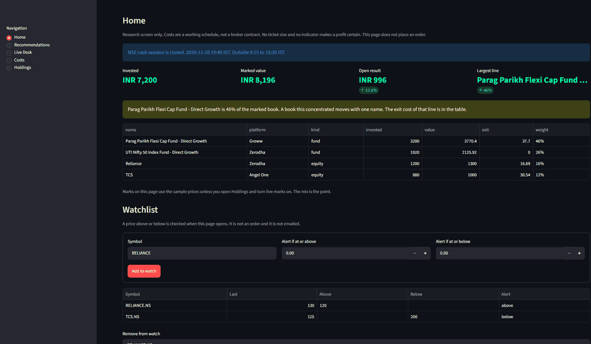
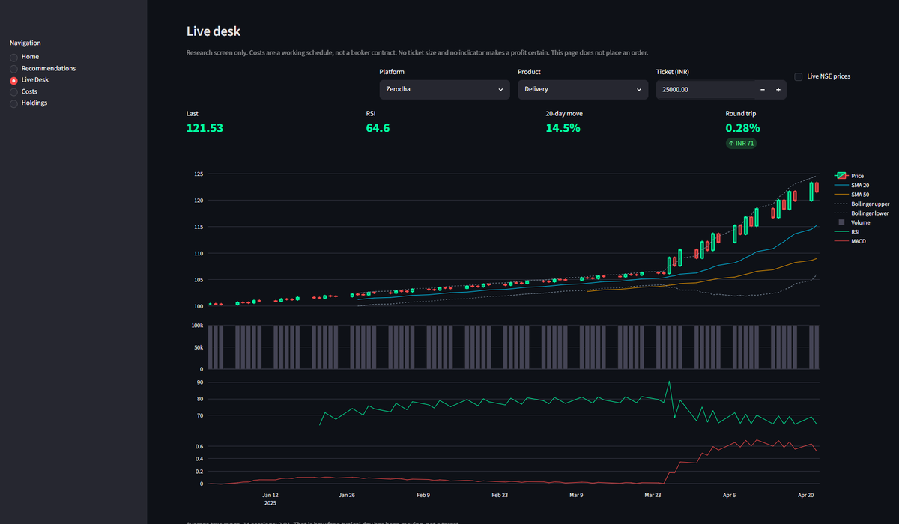
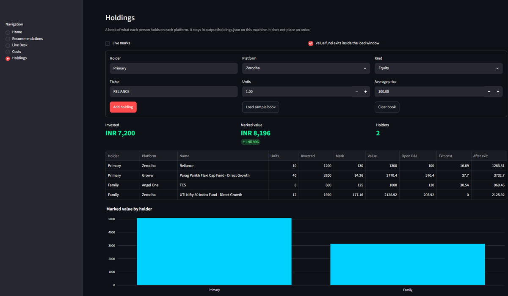

# SmartTrader Pro

[](https://www.python.org/downloads/)
[](https://opensource.org/licenses/MIT)

An Indian-market desk for the NSE and BSE. It turns capital, risk, and a time horizon into a sized book, prices the round trip on Zerodha, Groww, Upstox, Angel One, and Shoonya, and keeps a local record of who holds what. A research screen. It does not promise a profit, and the recommendation pages do not place an order.

<p align="center">
  
</p>

The shots below are the sample market, so the desk opens with no broker login. Live NSE prices are a checkbox.

| Home | Book |
| --- | --- |
|  |  |

| Chart | What the platforms charge |
| --- | --- |
|  |  |



## What a recruiter can see in the code

* **A book, not a tip.** Capital, risk, and horizon become share counts, a stop, a target, and the cash left over. One name per sector when the book has room. A falling market raises cash.
* **Indian costs, not a flat fee.** Delivery and intraday on five brokers, including STT, stamp duty, the exchange fee, GST, and the DP charge on a sell. The page also shows the smallest ticket that keeps those charges under a limit, and the SIP floor on a direct-plan mutual fund.
* **A chart that knows the cost.** Candles, two moving averages, Bollinger bands, RSI, MACD, and the 14-session average true range. A name is flagged only when the recent swing is larger than the round trip. The flag is a screen.
* **A book of holders.** Shares and mutual funds, tagged by person and platform, with the open result and the cost of leaving. The file stays on the machine.
* **A local model, if you have one.** An optional note beside the book. The share count is already decided. No model is required to run the desk.
* **Tests around the money.** The book, the brokerage cards, the session clock, and the model parser are covered. A refused model reply cannot change a position.

The same repository also has the older trading loop: regime detection, Kelly sizing, a paper book, and a Shoonya connection for someone who wants to go from research toward execution. That path is separate from the recommendation pages.

## Stack

Python 3.10, pandas, NumPy, Streamlit, Plotly, and pytest. Prices can come from Yahoo Finance. Sentiment can come from a local FinBERT server. Neither is required for the sample market.

## Run it

```bash
git clone https://github.com/SamaelSama69/SmartTrader-X.git
cd SmartTrader-X
python -m venv venv
venv\Scripts\activate
pip install -r requirements.txt

# The desk
python -m streamlit run dashboard_v2.py

# A book from the sample market, no network and no model
python -m recommender --demo --capital 500000 --risk balanced --horizon both

pytest tests/ -q
```

Copy `.env.example` to `.env` only when you want a broker, a news key, or the optional local model. Blank is a working default.

## More writing

* [Indian Market Guide](docs/INDIAN_TRADING_GUIDE.md)
* [Beginner API Setup](docs/BEGINNER_API_SETUP.md)
* [Auto-Trading Guide](docs/AUTO_TRADING_GUIDE.md)
* [System Architecture](docs/COMPREHENSIVE_GUIDE.md)

## Disclaimer

Educational and research software. Markets can fall by more than any fee schedule. Nothing in this repository is a recommendation to buy or sell a security.
