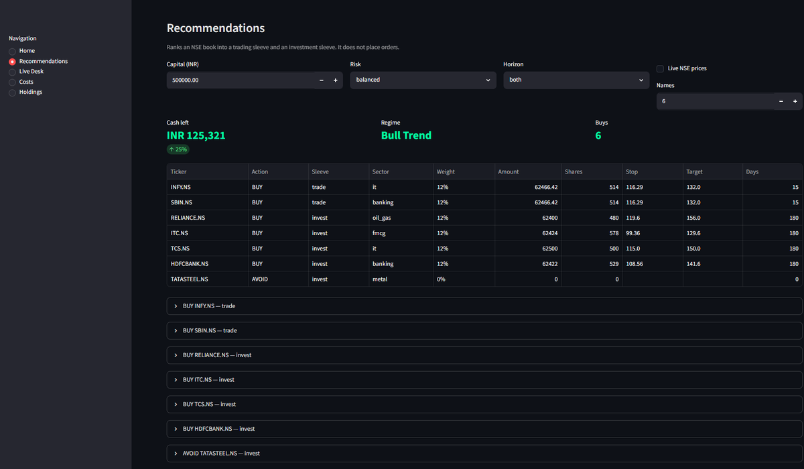
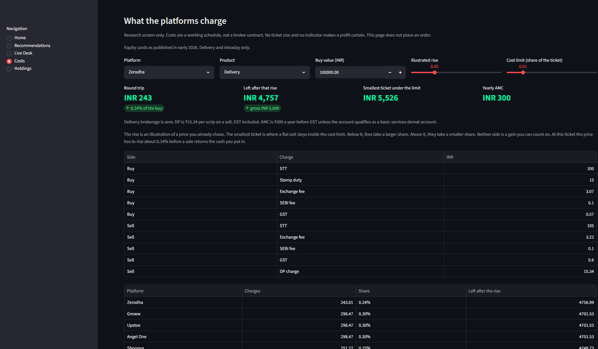

<p align="center">
  
  
  
  
  
  
  
  
  
  
  
</p>

<h1 align="center">SmartTrader Pro</h1>

<p align="center">
  <b>Size a book. Price the round trip. See who holds what.</b><br>
  A research desk for the NSE and BSE. You give it capital, a risk level, and a horizon.<br>
  It answers with share counts, a stop, a target, the cash left over, and what a broker would charge to get in and out.
</p>

<p align="center">
  
</p>

<p align="center">
  <sub>The pictures are the sample market, so the desk opens with no broker login and no model. Live NSE prices are a checkbox on the chart and on the book.</sub>
</p>

---

## A session on the desk

The sidebar opens on **Home**. The clock says whether the NSE cash session is in the regular 9:15 to 15:30 IST window, on a weekend, or on a holiday from the list in the project. Under that, the holdings file is marked up: invested amount, current value, open result, and the largest line. If one name is a quarter or more of the marked book, the page says so. A watchlist underneath stores a price above and a price below, and checks them when the page opens. The file stays on this machine.


**Recommendations** is the book itself. A profile is four choices: capital, risk (`conservative`, `balanced`, or `growth`), horizon (`trading`, `investment`, or `both`), and how many names. Sixty closes are required before a name is scored. The score looks at the 20-day return, the 60-day return, annualized volatility, the position against the 50-day average, and the drawdown from the 60-day high.

A name lands in the sleeve with the higher score. A tie stays in the investment sleeve. The trading sleeve is a 15-day idea: the stop sits between 4% and 12% under the last price, and the target is twice that distance above it. The investment sleeve is a 180-day idea: the stop sits between 8% and 20%, and the target is 20% above the last price. Shares are a whole number, so the cash on the page is the rupees that did not buy a share, not a rounded weight.

A name with a 60-day return worse than −8% and a drawdown worse than −12% is listed as avoid, up to three names, with zero weight. When the book has room, it takes one name from a sector and skips the next name in that same sector.



| Risk | Cash set aside | Largest name | Share of the invested part aimed at trades | Minimum score |
| --- | ---: | ---: | ---: | ---: |
| Conservative | 45% | 10% | 20% | 0.60 |
| Balanced | 25% | 16% | 40% | 0.50 |
| Growth | 10% | 22% | 65% | 0.45 |

A horizon of `trading` puts 85% of the invested part toward the short sleeve. A horizon of `investment` puts none of it there. In a bearish tape the cash floor rises by 15 points, capped at 70%, and the trading budget is cut in half. The regime is read from the panel in front of you: a median 20-day return above 3% is a bull trend, below −3% is a bear trend, and the middle is sideways.

**Live Desk** is one symbol. Candles, the 20-day and 50-day averages, Bollinger bands, volume, RSI, MACD, and the 14-session average true range. A name is marked only when four things are true together: price is above both averages, RSI is between 45 and 68, the MACD histogram is positive, and the last 20 sessions moved by more than a round trip on the platform and ticket you picked. The mark is a screen.


**Costs** prices that round trip. Delivery and intraday, for Zerodha, Groww, Upstox, Angel One, and Shoonya. The lines are brokerage, STT, stamp duty, the NSE transaction charge, the SEBI fee, GST, and the DP charge when shares leave the demat account. You set a cost limit as a share of the ticket. The page finds the smallest buy, sold flat, that stays inside it. If stamp duty and STT alone are already above the limit, it says the limit cannot be reached. An illustrated rise shows what would be left after charges if the price did move by the amount you typed. The rise is yours to choose. It is not a forecast.

Under the equity card, four direct-plan funds are listed with a working expense ratio, an exit load, and the AMC minimum SIP and lump sum. The minimum is the smallest amount the fund will accept. The expense ratio is already inside the published NAV. A direct plan costs the same expense ratio on Groww, Zerodha Coin, Upstox, Angel One, Shoonya, or the fund house.



**Holdings** is the book you already own. Each row is a person, a platform, a share or a fund, the units, and the average price. The page marks it, shows the open result, and prices the cost of selling: the sell-side charges for a share, or the exit load for a fund if you are still inside the load window. Two holders on the same machine show up as two bars.


The same dashboard continues into the older trading screens: market pulse, a news hub, a strategy scanner, deep analysis, a portfolio hub, a performance report, a testing lab, and an actions hub. Those screens are where the regime engine, the paper book, and the Shoonya login live.

## What the numbers are doing

| Piece | Where it lives | What you get |
| --- | --- | --- |
| Book | `recommender/engine.py` | Scores, sleeves, share counts, stops, targets, cash |
| Prices | `recommender/data.py` | A deterministic sample panel, or Yahoo Finance for the NSE large-cap list |
| Costs | `recommender/costs.py` | A round trip and the smallest ticket under a cost limit |
| Funds | `recommender/funds.py` | Direct-plan minimums, expense ratio, exit load, and a NAV read from the public feed when you ask for live marks |
| Chart | `recommender/indicators.py` | RSI, MACD, Bollinger bands, average true range |
| Clock | `recommender/market_clock.py` | Open, closed, or holiday, in India time |
| Holdings | `recommender/ledger.py` | `output/holdings.json` on this machine |
| Watchlist | `recommender/watch.py` | `output/watchlist.json` on this machine |
| Notes | `recommender/brief.py` | Three sentences, only if `QWEN_MODEL` is set and you press the button |

`output/` is gitignored. A fresh clone has an empty book and an empty watchlist until you add a row or load the sample.

## Costs, in one example

A delivery buy of ₹1,00,000 on Zerodha pays no brokerage. It still pays 0.1% STT on the buy and 0.1% on the sell, 0.015% stamp duty on the buy, the exchange fee, a small SEBI fee, GST on the exchange fee, and ₹15.34 of DP charge when the shares are sold. On a sale 5% higher, the round trip in this schedule is about ₹243, and about ₹4,757 of the ₹5,000 rise is left. Groww, Upstox, and Angel One cost more on that same ticket because of brokerage and a higher DP charge. Shoonya’s delivery brokerage is ₹0, with a higher DP line than Zerodha in this schedule.

The cards follow published schedules from early 2026. Delivery STT here is 0.1% on both sides. The NSE equity transaction charge is the March 2026 rate. Confirm the contract note before sending money. A yearly account maintenance charge is shown beside the trade. It is not inside the round trip. A basic services demat account can waive it when the PAN has a single demat account and the holdings are small. Shoonya and Groww, left open, count as other demat accounts.

## A local model, if you want one

The book is finished before any model is asked. Press **Ask the local model** on the recommendations page and, if `QWEN_MODEL` is set, the desk sends the book, one round trip, and the holdings mix to an OpenAI-compatible server. The default address is `http://192.168.10.3:8998/v1`, which is where a local **Qwen** build can sit (the machine used while writing this runs Qwen 3.6 35B AWQ). The client does not care about the brand. Any chat model that speaks `/v1/chat/completions` works: Qwen, Llama, Mistral, or another local server. Put that server's model id in `QWEN_MODEL`.

The reply has to be three notes: trend, cost, and news. A missing model, a server that does not answer, or a reply that is not those three notes leaves the share counts where the engine put them. With no headlines attached, the news line says so.

**FinBERT** (`ProsusAI/finbert`) is a different model and a different job. It scores headlines as a number, through PyTorch, Transformers, and an optional OpenVINO path, and it is served by the FastAPI app in `sentiment_server.py`. VADER covers a headline when the transformer is not loaded. Neither model is required for the sample desk.

```env
# leave these commented and the desk still runs
# QWEN_BASE_URL=http://192.168.10.3:8998/v1
# QWEN_MODEL=
# QWEN_API_KEY=
```

## The trading loop beside the desk

The recommendation pages stop at a sized book. The rest of the repository is the execution research that was here first.

* **Regime.** Bull, bear, and volatility change the parameters the strategies use.
* **Kelly sizing.** Position size follows a dynamic Kelly estimate, with a cap.
* **Circuit check.** An order path refuses a name trading within 0.5% of a circuit limit.
* **Sentiment.** News, a local FinBERT model, and a keyword fallback. If one source is down, the next one is used.
* **Calendar.** NSE holidays are listed, and size is reduced during earnings-season months.
* **Paper, then Shoonya.** The paper book runs with no login. Shoonya is the live broker connection, and it stays off until you connect it and choose a live mode.
* **Square-off.** The intraday loop is written to be flat by 3:15 PM IST.

Those pieces are documented in the guides at the bottom. They do not rewrite the recommendation book.

## Layout

```text
SmartTrader-X/
├── recommender/          Book, costs, funds, chart, holdings, optional notes
├── dashboard_v2.py       Streamlit desk
├── strategies/           Momentum, stocks, options
├── utils/                Regime, risk, backtest, Shoonya, sentiment, paper book
├── tests/                Book, costs, chart, session, notes, and the older engine
├── auto_bot.py           Headless loop
├── indian_config.py      Universe, sectors, holidays, tax constants
├── docs/                 Setup and market notes
└── assets/readme/        The pictures on this page
```

## Stack

| | Libraries and models |
| --- | --- |
| Language | Python 3.10 or newer |
| Data | pandas, NumPy, SciPy, Yahoo Finance through `yfinance`, the public MF NAV feed |
| Desk | Streamlit, Plotly, Matplotlib, Seaborn |
| Research book | The `recommender` package. No extra model. |
| Broker and calendar | `NorenRestApiPy` for Shoonya, `pyotp` for the login code, `pytz` for India time |
| News | `feedparser`, `vaderSentiment`, `praw` for Reddit, requests |
| Sentiment model | FinBERT, `ProsusAI/finbert`, on PyTorch and Hugging Face Transformers. OpenVINO and Optimum are the faster local path. Sentence-Transformers and XGBoost are in the optional ML requirements. |
| Notes model | Any OpenAI-compatible local chat model. Qwen is the one this desk was pointed at. Llama and Mistral work the same way if you set `QWEN_MODEL` to their id. |
| Service | FastAPI and Uvicorn for the sentiment server |
| Backtest | A pandas backtester in the repo. vectorbt is optional, in `requirements-ml.txt`. |
| Tests | pytest |

A Shoonya login, news keys, FinBERT, and the local chat model are all optional. The sample market runs on pandas and the files in `recommender/`.

## Run

```bash
git clone https://github.com/SamaelSama69/SmartTrader-X.git
cd SmartTrader-X
python -m venv venv
venv\Scripts\activate
pip install -r requirements.txt

# Desk. Home, book, chart, costs, holdings.
python -m streamlit run dashboard_v2.py

# Book from the sample market. No network, no model, no broker.
python -m recommender --demo --capital 500000 --risk balanced --horizon both

# Same book from live NSE large-cap prices.
python -m recommender --capital 500000 --risk balanced --horizon investment

pytest tests/ -q
```

On Windows the same entry points are `run.bat`, `scripts\run_gui.bat`, `scripts\run_autobot.bat`, and `scripts\run_sentiment_server.bat`.

Copy `.env.example` to `.env` when you want Shoonya, a news key, or the optional model. Leaving it absent is a working way to run the sample desk.

```env
SHOONYA_USER_ID=
SHOONYA_PASSWORD=
SHOONYA_TOTP_KEY=
SHOONYA_VENDOR_CODE=
SHOONYA_API_KEY=

NEWS_API_KEY=
FINNHUB_API_KEY=
```

## Guides

| Guide | What it covers |
| --- | --- |
| [Indian market rules](docs/INDIAN_TRADING_GUIDE.md) | Slippage, STT, and market conventions |
| [API setup](docs/BEGINNER_API_SETUP.md) | Keys for Shoonya, news, and the rest |
| [Auto-trading](docs/AUTO_TRADING_GUIDE.md) | The headless loop and the paper path |
| [Architecture](docs/COMPREHENSIVE_GUIDE.md) | How the older engine is wired |
| [Examples](docs/EXAMPLES.md) | Strategy snippets |

## Tests

```bash
pytest tests/ -q
```

The suite covers the book math, the five brokerage cards, the session clock, the watchlist file, the concentration of a holdings book, a smooth price series on the RSI, and a model reply that is not JSON. The recommendation tests build a book from the sample panel, so they do not call a network.

---

<p align="center">
  <sub>Educational and research software. A sized book and a fee schedule are not a forecast. Nothing in this repository is a recommendation to buy or sell a security.</sub>
</p>
