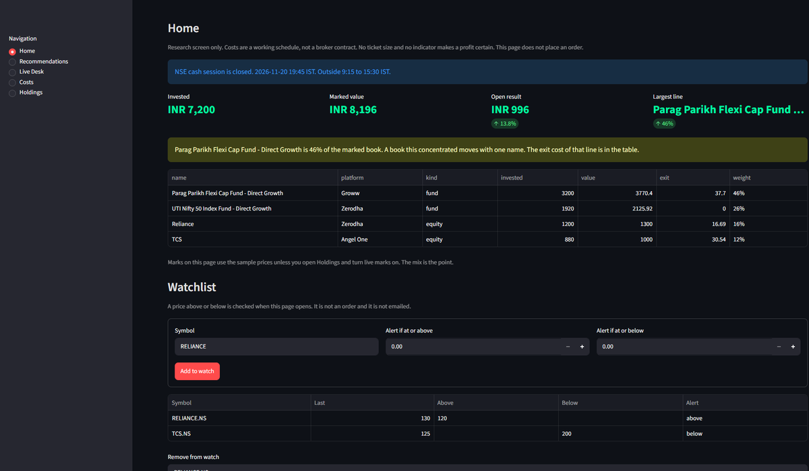

<p align="center">
  
  
  
</p>

<h1 align="center">SmartTrader Pro</h1>

<p align="center">
  <b>Size a book. Price the round trip. See who holds what.</b><br>
  A research desk for the NSE and BSE. Capital, risk, and horizon become share counts, a stop, and the cash left over.
</p>

<p align="center">
  
</p>

<p align="center">
  <sub>Sample market, so the desk opens before any broker login. Live NSE prices are a checkbox.</sub>
</p>

<br>

<table>
<tr>
<td width="50%" valign="top">
<br>
<b>Home</b><br>
<sub>Session clock, the mix of the book, and a price to watch.</sub>
</td>
<td width="50%" valign="top">
<br>
<b>Book</b><br>
<sub>Six names, cash left, and one name set aside.</sub>
</td>
</tr>
<tr>
<td width="50%" valign="top">
<br>
<b>Chart</b><br>
<sub>Candles, bands, RSI, MACD, and the cost of a round trip on the same page.</sub>
</td>
<td width="50%" valign="top">
<br>
<b>Costs</b><br>
<sub>Zerodha, Groww, Upstox, Angel One, and Shoonya on one ticket.</sub>
</td>
</tr>
</table>

<p align="center">
  <br>
  <b>Holdings</b><br>
  <sub>Shares and funds by person and platform, with the open result and the cost of selling.</sub>
</p>

<br>

## The desk

| | |
| --- | --- |
| **Book** | Capital, risk, and horizon become a weight, a share count, a stop, a target, and the cash left over. One name per sector when the book has room. A falling market raises cash. |
| **Costs** | Delivery and intraday on five Indian brokers: STT, stamp duty, the exchange fee, GST, and the DP charge on a sell. The page shows the smallest ticket that keeps those charges under a limit you set, and the SIP floor on a direct plan. |
| **Chart** | Moving averages, Bollinger bands, RSI, MACD, and the 14-session average true range. A name is marked when the last 20 sessions moved more than the round trip. |
| **Holdings** | A local file of shares and mutual funds, tagged by holder and platform. |
| **Notes** | An optional note from a local model, beside a book that is already sized. The desk runs with no model configured. |
| **Tests** | The book, the brokerage cards, the session clock, and the note parser. |

Regime detection, Kelly sizing, a paper book, and a Shoonya connection live in the same repository, on a separate path from these pages.

## Stack

`Python 3.10` · `pandas` · `NumPy` · `Streamlit` · `Plotly` · `pytest`

Prices can come from Yahoo Finance. Sentiment can come from a local FinBERT server. The sample market needs neither.

## Run

```bash
git clone https://github.com/SamaelSama69/SmartTrader-X.git
cd SmartTrader-X
python -m venv venv
venv\Scripts\activate
pip install -r requirements.txt

python -m streamlit run dashboard_v2.py
python -m recommender --demo --capital 500000 --risk balanced --horizon both
pytest tests/ -q
```

Copy `.env.example` to `.env` when you want a broker, a news key, or the optional local model. A blank environment is enough for the sample market.

## Guides

[Indian market rules](docs/INDIAN_TRADING_GUIDE.md) · [API setup](docs/BEGINNER_API_SETUP.md) · [Auto-trading](docs/AUTO_TRADING_GUIDE.md) · [Architecture](docs/COMPREHENSIVE_GUIDE.md)

---

<p align="center">
  <sub>Educational and research software. A fee schedule is not a forecast. Nothing here is a recommendation to buy or sell a security.</sub>
</p>
